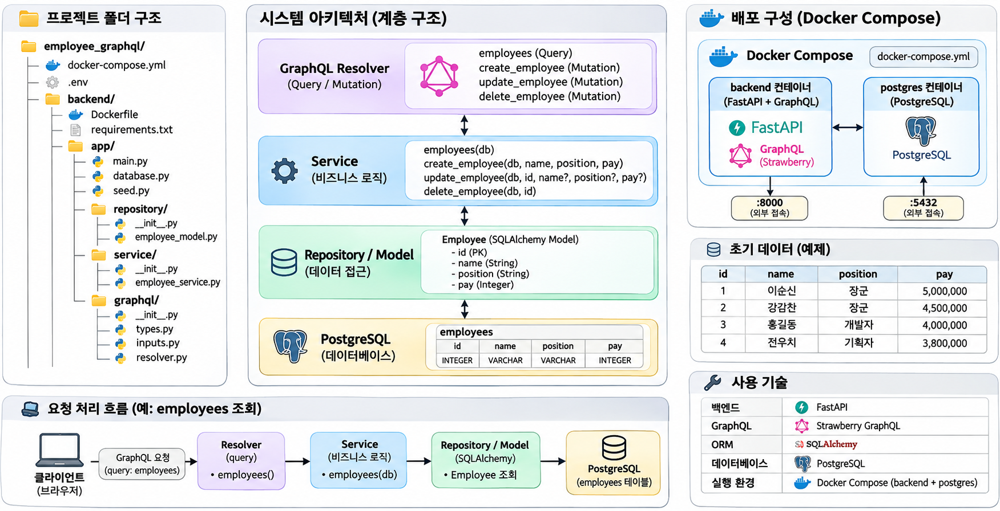
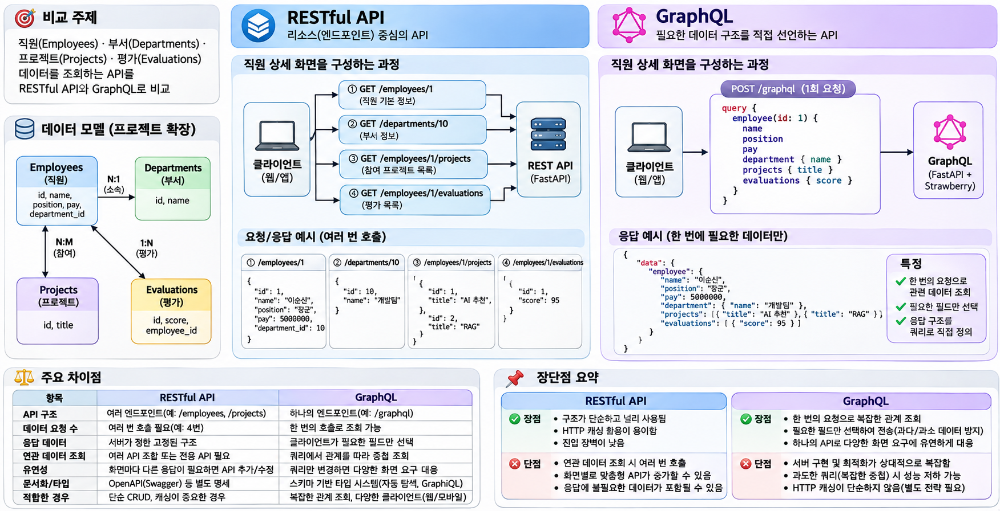
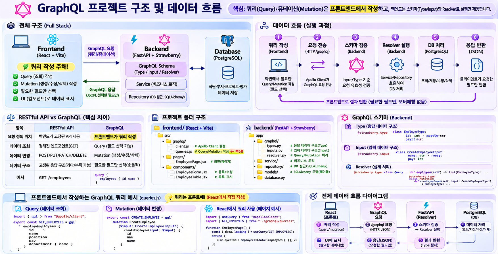

# Employee Management — GraphQL Full Stack

React(Vite) 프론트엔드에서 **GraphQL Query/Mutation을 직접 정의**하고, FastAPI + Strawberry 백엔드가 요청을 처리하여 PostgreSQL의 직원 데이터를 조회·관리하는 학습 프로젝트입니다.

## 1. GraphQL 소개



GraphQL은 클라이언트가 **필요한 응답 필드를 직접 선택**하는 API 질의 언어입니다. 프론트엔드가 작성한 Query/Mutation은 백엔드에서 정의한 GraphQL Schema(Type, Input, Query, Mutation)에 따라 검증·실행됩니다.

- **Query**: 직원 목록, 부서, 프로젝트, 평가 정보 조회
- **Mutation**: 직원 생성, 수정, 삭제
- **Type**: 클라이언트가 조회할 수 있는 응답 필드의 형태
- **Input**: 서버가 받을 입력 데이터의 형태
- **Resolver**: GraphQL 요청을 Service 로직에 연결하는 함수

## 2. REST API vs GraphQL



| 항목 | REST API | GraphQL |
|---|---|---|
| API 진입점 | 여러 URL (`/employees`, `/employees/{id}` 등) | 주로 단일 URL (`/graphql`) |
| 조회 | `GET` | `Query` |
| 생성·수정·삭제 | `POST`, `PUT/PATCH`, `DELETE` | `Mutation` |
| 응답 필드 | 서버가 엔드포인트별로 설계 | 프론트엔드가 요청할 필드 선택 |
| 서버 처리 | Router → Service → Repository | Resolver → Service → Repository |

> GraphQL을 사용하더라도 **데이터 접근 권한과 비즈니스 규칙은 백엔드에서 검증**해야 합니다. GraphQL 요청 한 번이 SQL 쿼리 한 번을 뜻하는 것은 아닙니다.

## 3. 프로젝트 구조 및 데이터 흐름



**핵심:** GraphQL Query/Mutation 문서는 `frontend/src/graphql/queries.js`에서 작성합니다. 백엔드는 허용된 스키마를 정의하고 Resolver를 실행합니다.

```text
graphQL_project/
├── .env
├── docker-compose.yml
├── backend/
│   ├── Dockerfile
│   ├── requirements.txt
│   └── app/
│       ├── main.py
│       ├── database.py
│       ├── seed.py
│       ├── graphql/
│       │   ├── types.py           # GraphQL 응답 Type
│       │   ├── inputs.py          # GraphQL 입력 Input
│       │   └── resolver.py        # Query / Mutation 구현
│       ├── service/
│       │   └── employee_service.py
│       └── repository/
│           └── employee_model.py  # SQLAlchemy 모델
└── frontend/
    ├── package.json
    ├── vite.config.js
    ├── index.html
    └── src/
        ├── main.jsx
        ├── App.jsx
        ├── graphql/
        │   ├── client.js          # Apollo Client 설정
        │   └── queries.js         # Query / Mutation 작성 ★
        ├── pages/
        │   └── EmployeePage.jsx
        └── components/
            ├── EmployeeForm.jsx
            └── EmployeeTable.jsx
```

### 요청 처리 흐름

```text
[React: EmployeePage.jsx]
       │ useQuery / useMutation
       ▼
[Frontend: graphql/queries.js]  ← Query/Mutation 문서 작성
       │
       ▼
[Apollo Client] ── HTTP POST /graphql ──▶ [FastAPI + Strawberry]
                                              │
                                              ▼
                                       [GraphQL Schema]
                                       Type / Input 검증
                                              │
                                              ▼
                                        [Resolver]
                                              │
                                              ▼
                                        [Service]
                                              │
                                              ▼
                                    [SQLAlchemy Repository]
                                              │
                                              ▼
                                         [PostgreSQL]
                                              │
                  ◀────────── 선택한 필드의 JSON 응답 ──────────┘
```

### 프론트엔드 Query 예제 (`frontend/src/graphql/queries.js`)

```javascript
import { gql } from "@apollo/client";

export const GET_EMPLOYEES = gql`
  query GetEmployees {
    employees {
      id
      name
      position
      pay
      department { name }
      projects { title }
      evaluations { score }
    }
  }
`;

export const CREATE_EMPLOYEE = gql`
  mutation CreateEmployee($input: CreateEmployeeInput!) {
    createEmployee(input: $input) {
      id
      name
      position
      pay
    }
  }
`;
```

### React에서 호출 (`frontend/src/pages/EmployeePage.jsx`)

```jsx
import { useQuery, useMutation } from "@apollo/client/react";
import { GET_EMPLOYEES, CREATE_EMPLOYEE } from "../graphql/queries";

// EmployeePage 컴포넌트 내부
const { data, loading, error } = useQuery(GET_EMPLOYEES);
const [createEmployee] = useMutation(CREATE_EMPLOYEE);

// 직원 생성 예시
await createEmployee({
  variables: {
    input: { name: "김유신", position: "개발자", pay: 4200000 }
  }
});
```

## 4. 기술 스택

| 계층 | 기술 |
|---|---|
| Frontend | React, JavaScript, Vite, styled-components |
| GraphQL Client | Apollo Client, graphql |
| Backend | Python, FastAPI, Strawberry GraphQL |
| ORM | SQLAlchemy |
| Database | PostgreSQL 16 |
| Infrastructure | Docker Compose |

## 5. 로컬 실행

### PostgreSQL 실행

프로젝트 루트에서:

```powershell
docker compose up -d postgres
```

### Backend 실행 (Windows PowerShell)

프로젝트 루트에 `.venv`가 생성되어 있다는 전제입니다.

```powershell
cd backend
..\.venv\Scripts\python.exe -m uvicorn app.main:app --reload --port 8000
```

### Frontend 실행

별도 터미널에서 프로젝트 루트 기준:

```powershell
cd frontend
npm install
npm run dev
```

| 서비스 | 주소 |
|---|---|
| React | http://localhost:5173 |
| GraphQL IDE | http://localhost:8000/graphql |
| FastAPI Docs | http://localhost:8000/docs |

> Vite 개발 서버의 `/graphql` 프록시는 `http://localhost:8000`을 가리키도록 설정합니다. 이미 Docker에서 백엔드가 8000번 포트를 사용 중이면 로컬 Uvicorn과 동시에 실행하지 마세요.

## 6. GraphQL 요청 예시

```graphql
query {
  employees {
    id
    name
    department { name }
    projects { title }
    evaluations { score }
  }
}
```

```graphql
mutation {
  createEmployee(input: {
    name: "김유신"
    position: "개발자"
    pay: 4200000
  }) {
    id
    name
  }
}
```

## 7. GitHub 업로드

프로젝트 루트에서 `README.md`와 `docs/images/`를 추가한 뒤 실행합니다.

```powershell
git status
git add README.md docs/images
git commit -m "docs: add GraphQL README and architecture diagrams"
git push origin main
```

> 이 문서는 현재 대화에서 구성한 프로젝트를 기준으로 작성했습니다. 실제 로컬 소스와 폴더명이 다르면 해당 경로를 확인해 주세요.
